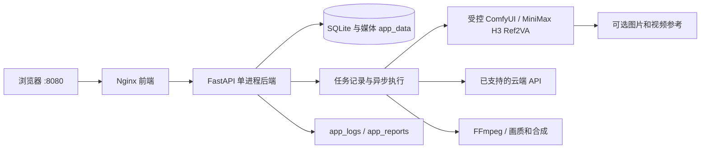

# AI 视频自动化工厂

把 Word 剧本、人物与产品参考、分镜制作、审核和 MP4 成片放在一条可追溯流程中。网页与业务后台通过 Docker Desktop 运行；模型权重和 GPU 推理环境由用户在自己的推理主机维护。

视频生成的本地路径为**直连 MiniMax H3 Ref2VA**：冻结后的镜头脚本、可选人物/产品图片和可选参考视频帧直接提交给已验证的 ComfyUI 原生节点。不会先启动独立语义编译器、代理服务或语言模型来改写脚本。

## 快速启动

安装 [Docker Desktop for Windows](https://docs.docker.com/desktop/setup/install/windows-install/) 或 [Docker Desktop for Mac](https://docs.docker.com/desktop/setup/install/mac-install/)，然后在含 `compose.yaml` 的目录运行：

```bash
git clone https://github.com/wAillZhAIng/video_2.git video-factory
cd video-factory
docker compose up -d
```

首次构建完成后打开 [http://127.0.0.1:8080](http://127.0.0.1:8080)。`compose.yaml` 构建当前下载的源码；数据位于 Docker 命名卷，重建镜像不会清空业务数据。应用主机不需要额外安装 Python、Node.js、SQLite 或 FFmpeg。

详细说明：[Windows](docs/INSTALL_WINDOWS.md) · [macOS](docs/INSTALL_MACOS.md) · [本地 H3 部署](docs/local-inference.md) · [故障排查](docs/TROUBLESHOOTING_ZH.md)。

## 配置本地 MiniMax H3 Ref2VA

在 GPU 主机独立安装 ComfyUI、MiniMax H3 Ref2VA 节点、模型权重与所需的 4-step LoRA。项目提供 `scripts/local_inference/` 的本地 ComfyUI 启动与检查工具，但不会下载、移动或打包模型权重。

在网页中依次选择：

1. **系统设置 → 添加服务 → 视频生成 → 本地 / 私有 ComfyUI**。
2. 内置工作流选择 **MiniMax H3 原生 Ref2VA：Fast 4 / 标准 20 / 高质量 30**。
3. 填写可从应用访问的 ComfyUI origin。Docker Desktop 同机部署通常使用 `http://host.docker.internal:8189`；直接在 GPU 主机运行应用时使用该 ComfyUI 的实际监听地址。不要把容器中的 `localhost` 当成宿主机。
4. 勾选“确认这是我管理的本地模型服务”，保存并测试连接。

连接测试会核对已安装的节点和模型接口；它不等于真实出片验收。服务必须保持私有并只允许受控网络访问。云端服务仍须使用已实现的协议和 HTTPS，不应把普通聊天或模型列表接口当作视频接口。

## 三档视频制作与参考素材

| 网页选项 | 原生工作流 | 采样步骤 |
| --- | --- | --- |
| Fast | `h3_ref2va_native_fast4_v2.json`（保留 SMD 4-step LoRA 配方） | 4 |
| 标准 | `h3_ref2va_native_quality20_v2.json` | 20 |
| 高质量 | `h3_ref2va_native_quality30_v2.json` | 30 |

脚本始终决定要生成的内容；产品或人物图片决定视觉身份；参考视频可选择动作、运镜、画面风格或综合参考。参考视频会经 FFmpeg/FFprobe 验证、裁剪与 24 FPS 预处理后，以真实视频帧接入 H3 的原生参考输入，而不是把文件路径写入提示词。详情见[参考图片与视频](docs/REFERENCE_MEDIA_ZH.md)。

每个已派发任务都冻结工作流、采样步骤、服务、脚本和素材哈希。之后修改项目设置只影响尚未派发的任务。超分输出尺寸与模型原生生成尺寸是两件事；只有实际 AI 超分成功并通过媒体检查，任务才会完成对应的后处理阶段。

## 从 Word 到成片

1. 在项目工作台下载 [剧本模板.docx](docs/templates/剧本模板.docx)，或上传自己的兼容 Word 文档。
2. 导入后核对脚本、人物、场景和分镜；需要保持外观时，按镜头绑定人物或产品图片。
3. 可选地在项目级或镜头级上传/选择参考视频，设置用途和片段时间。没有参考视频时，图片参考和纯脚本路径照常可用。
4. 选择 Fast、标准或高质量，开始制作。系统保留真实任务状态与错误，不对结果未知的请求重复提交。
5. 成片区域会在分镜完成后自动合成并提供预览和下载；人工审核仍用于确认人物、商品、动作、声音和画质是否符合预期。

操作细节见[完整使用教程](docs/USER_GUIDE_ZH.md)。对白超长和审核修订会新建受影响素材版本，原片、原配音与历史任务保持可追溯；参见[对白超长处理](docs/对白超长处理.md)和[视频修订与配音恢复](docs/视频修订与配音恢复.md)。

## 服务、数据与维护



Compose 只有前端和后端服务；SQLite 与任务队列不需要另装 PostgreSQL 或 Redis。后端必须保持单进程，不要同时启动多份后端共享同一套数据卷。

`app_data` 保存数据库、用户素材、生成结果和 `/app/data/.secrets/master.key`；`app_logs`、`app_reports` 保存日志和报告。升级前先备份：Windows 使用 `./scripts/backup-docker.ps1`，macOS 使用 `bash ./scripts/backup-docker.sh`。普通升级运行 `docker compose up -d`；不要把 `docker compose down -v` 当作更新命令。

```bash
docker compose ps
docker compose logs --tail=100 backend frontend
docker compose exec backend python -m app.container_entrypoint doctor
```

`application_ready: true` 只表示应用基础服务就绪；外部模型、真实生成与成片播放仍需单独验证。

## 其他部署方式

- **预构建发行镜像：** `docker compose -f compose.prebuilt.yaml up -d`。它可能早于当前源码；先核对版本、数据库兼容性和[发布记录](docs/RELEASE_VALIDATION.md)，不要把旧镜像直接降级到新版数据库。
- **独立开发环境：** `docker compose -f compose.dev.yaml up -d --build`，默认项目为 `video-factory-dev`、端口为 `18083`，避免与正式业务卷混用。
- **可选部署参数：** `.env.example` 可调整端口、镜像源和管理员默认地址；真实 API Key 只在设置页输入并加密保存，绝不提交到仓库。

模型许可、显存要求和运行框架限制由用户按模型官方说明核对。项目自有代码许可见 [LICENSE](LICENSE)，第三方内容见 [THIRD_PARTY_NOTICES.md](THIRD_PARTY_NOTICES.md)。
